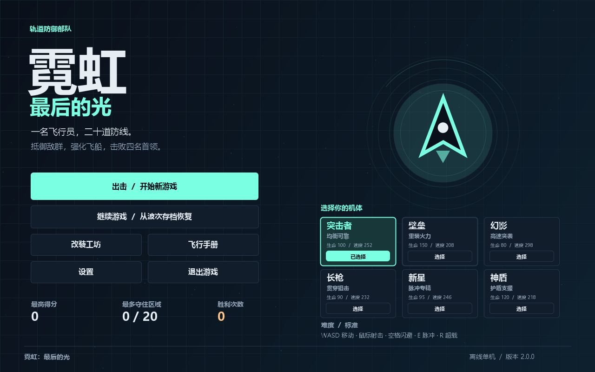
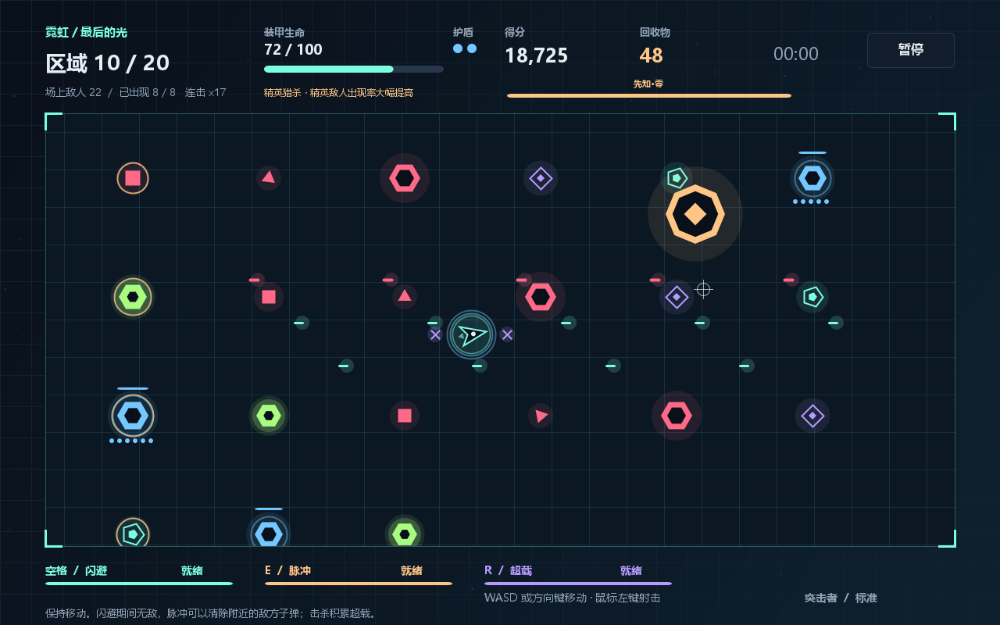
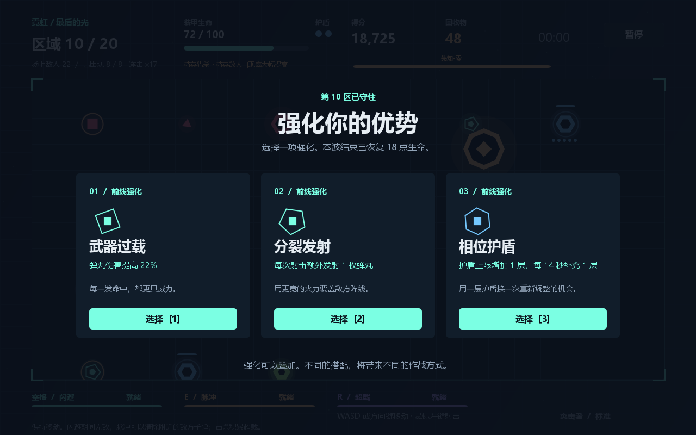
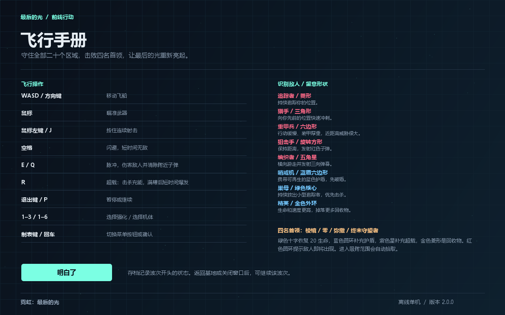
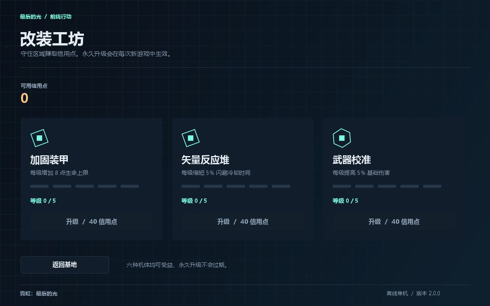
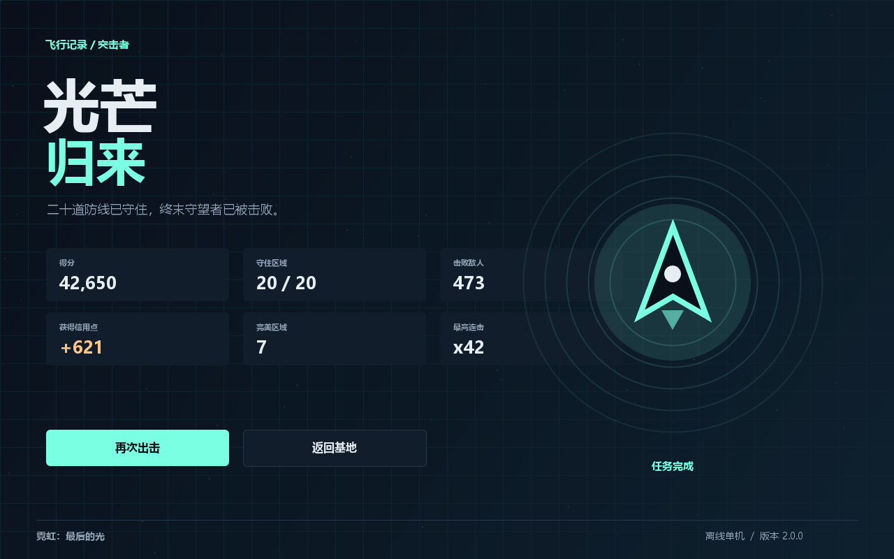
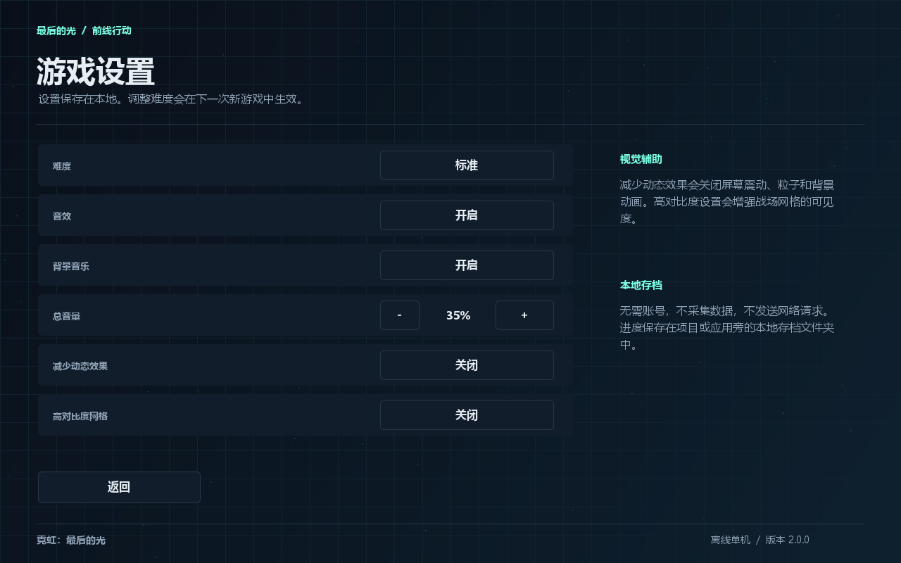
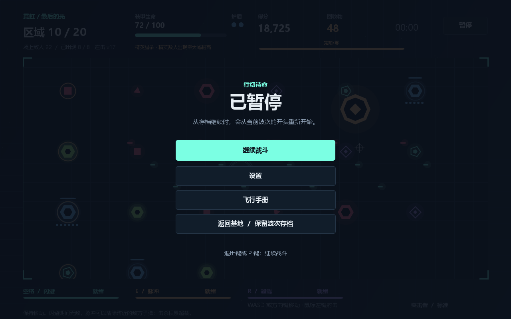

# 霓虹：最后的光 · Neon Last Light

一款可完整游玩的原创单机俯视角射击游戏，同时也是 Java 21 学习项目。代码、美术和音效都在本项目里：不依赖游戏引擎，不需要联网、账号、API Key 或外部素材。

**2.0 远征版**把战役扩展到 **20 个区域、4 名首领、6 种机体、8 类敌人、17 种局内强化**，并加入护盾、超载、连击、无人机、精英敌人和波次修正。

## 界面截图

| 主菜单 / 六种机体 | 战斗界面 |
| --- | --- |
|  |  |

| 波次强化 | 飞行手册 |
| --- | --- |
|  |  |

| 改装工坊 | 结算 |
| --- | --- |
|  |  |

| 设置 | 暂停 |
| --- | --- |
|  |  |

> 截图由游戏自身的 Java2D 渲染器离屏生成，与实机画面一致。

## 2.0 新增内容

- **战役扩展**：12 区 → 20 区，首领改为第 5、10、15、20 区，共四名。
- **三种新机体**：长枪（贯穿狙击）、新星（脉冲专精）、神盾（护盾支援）。
- **三种新敌人**：编织者（横向游走 + 三向弹幕）、哨戒机（可再生护盾）、巢母（持续放出追踪者）。
- **精英敌人**：金色外环，生命、速度和掉落更高；精英猎杀波出现率大幅提高。
- **七种新强化**：暴击、链式电弧、追踪弹、相位护盾、吸血纳米、护卫无人机、反应装甲。
- **超载系统**：击杀积累超载槽，按 `R` 进入短时间爆发，射速与机动性提高。
- **连击系统**：连续击杀提高得分倍率，受伤会清空连击。
- **完美区域**：整区不损失装甲生命，结算额外得分与回收物。
- **波次修正**：蜂群警报、精英猎杀、离子风暴，改变每波节奏。
- **新掉落**：护盾补充、超载充能；首领掉落多种补给。
- **界面重做**：六机体选择、护盾槽、超载槽、连击、波次修正、敌人图鉴。

## 快速开始

双击 **`开始游戏.cmd`**。脚本自动寻找本机 JDK，首次运行会编译，然后打开游戏；不需要安装 Maven，也不需要管理员权限。

中文便携版位于 `dist\日期时间\霓虹最后的光\霓虹最后的光.exe`，自带 Java 运行时。复制时要复制整个 `霓虹最后的光` 文件夹，不要只复制 exe。

## 用 IDEA 打开

1. 在 IDEA 欢迎页选择“打开”，选中整个 `neon-last-light` 文件夹，作为 Maven 项目导入。
2. 打开“项目结构”，项目 SDK 选择 JDK 21；语言级别设为 21。
3. 运行 `src/main/java/studio/lastlight/Main.java`。
4. 调试可在 `GameModel.hurt()`、`GameModel.chooseUpgrade()` 等位置下断点。
5. 运行 `src/test/java/studio/lastlight/GameTests.java` 可执行无窗口回归测试。

如果 Maven 工具窗口没有自动加载，右键 `pom.xml` → “添加为 Maven 项目”。项目的 `构建并测试.cmd` 不依赖 Maven 下载，即使插件仓库暂时不可用也能编译和测试。

## 玩法

你驾驶最后一架防御飞船，守住 **20 个区域**。第 5、10、15、20 区分别出现哨卫·棱镜、先知·零、织网者·弥撒和终末守望者。每波结束选择一次强化，击败终末守望者即通关；失败或通关后结算信用点，用于改装工坊的永久升级。

### 操作

| 操作 | 按键 |
| --- | --- |
| 移动 | WASD 或方向键 |
| 瞄准 | 鼠标 |
| 连续射击 | 按住鼠标左键，或 J |
| 闪避 / 无敌短冲刺 | 空格 |
| 脉冲：范围伤害并清除附近敌方子弹 | E 或 Q |
| 超载：满槽后短时间强化火力与机动 | R |
| 暂停 / 恢复 | 退出键或 P |
| 选择强化 / 机体 | 1–3 / 1–6 |
| 菜单键盘操作 | 制表键 / 上档键+制表键 / 回车 |

### 六种机体

| 机体 | 定位 | 特点 |
| --- | --- | --- |
| 突击者 | 均衡 | 生命、速度、伤害都稳定，适合熟悉节奏。 |
| 壁垒 | 重装 | 高生命、慢速、高单发伤害。 |
| 幻影 | 高速 | 低生命、高机动、高射速。 |
| 长枪 | 贯穿狙击 | 高单发伤害，自带两层穿透，射速偏慢。 |
| 新星 | 脉冲专精 | 脉冲伤害更高、冷却更短，擅长清场。 |
| 神盾 | 护盾支援 | 开局携带护盾，装甲厚实，容错高。 |

### 敌人与首领

- **追踪者**：菱形，持续追踪玩家。
- **猎手**：三角形，向玩家先前位置冲刺。
- **重甲兵**：六边形，行动缓慢、装甲厚重。
- **狙击手**：旋转方形，远距离发射红色子弹。
- **编织者**：五角星，横向游走并发射三向弹幕。
- **哨戒机**：蓝盾六边形，携带可再生护盾，先破盾再打本体。
- **巢母**：绿色核心，持续放出小型追踪者，优先击杀。
- **精英**：金色外环，生命、速度和掉落更高。

首领拥有多阶段弹幕和召唤援军：棱镜以环形弹幕为主；零使用螺旋弹幕与编织者；弥撒召唤哨戒机并发射密集齐射；终末守望者进入更高频的混合弹幕。

### 强化与掉落

10 种原有强化（伤害、射速、生命、速度、分裂、穿透、回复、吸附、闪避、脉冲）之外，2.0 新增：

- **弱点扫描**：提高暴击率，暴击造成 1.8 倍伤害。
- **链式电弧**：命中时电弧跳跃到附近敌人。
- **智能弹道**：弹丸获得轻微追踪。
- **相位护盾**：增加护盾层数，定时补充。
- **吸血纳米**：击杀回复生命。
- **护卫无人机**：环绕无人机自动射击。
- **反应装甲**：受击时电爆伤害附近敌人。

绿色十字恢复 20 生命；蓝色圆环补充护盾；紫色星补充超载；金色菱形是回收物，影响得分和结算信用点。红色圆环表示敌人即将出现，靠近拾取物会自动吸附。

## 存档

IDEA 和项目 JAR 默认使用项目下的 `data/`；便携版使用应用目录下的 `data/`。所有数据留在本地，无遥测、广告或网络请求。

- `profile.properties`：信用点、永久升级、最佳成绩、胜利次数、设置。
- `checkpoint.properties`：当前波次开始时的存档，含机体、难度、生命、强化和分数。
- `.bak`：上一份备份；读取损坏存档时会尝试它。

中途返回主菜单、关闭窗口或意外退出，“继续游戏”都从当前波次开头重玩，不是任意帧精确续玩。选完强化进入下一波时更新检查点；新游戏会询问是否替换旧存档；失败或通关后结算信用点，清除本局检查点。相同 runId 不重复结算。

备份进度时复制整个 `data/`，或用 JVM 参数 `-Dlastlight.data=D:\自选目录` 指定存档位置。

## 构建和验证

PowerShell 在项目根目录执行：

```powershell
.\build.ps1 -Test
.\run.ps1
.\build.ps1 -Test -Portable
```

如果执行策略拦住脚本，双击对应的 cmd；它只给本次脚本进程传 `ExecutionPolicy Bypass`，不改系统策略。也可显式传 JDK：

```powershell
.\build.ps1 -Test -Jdk 'D:\DevTools\ci-jdk\jdk-21.0.12.1+1'
```

Maven 也可用：`mvn test`、`mvn package`。游戏没有第三方运行时依赖。

输出：`target/neon-last-light-2.0.0.jar`；`target/preview/` 含中文界面预览与拼图。`build.ps1 -Portable` 用 JDK 的 jpackage 生成带运行时的 Windows x64 便携目录，不依赖 WiX，也不装到 C 盘。

回归测试覆盖六种机体的完整 20 波自动战斗、护盾、无人机、强化、存档往返、坏档兜底、实体上限和九种界面离屏渲染。桌面包另含窗口输入、缩放、失焦暂停和菜单导航测试。

## 按这个顺序学 Java

1. **Main.java**：`main`、Swing 窗口、事件线程。
2. **Input.java**：集合、布尔值、按住与单次触发、向量方向。
3. **GameModel.java**：枚举、对象、列表、循环、状态机、delta time、碰撞、组合设计。
4. **GameRenderer.java**：Java2D、坐标变换、颜色、字体；画面与规则分离。
5. **GamePanel.java**：监听器、lambda、定时器、菜单与业务协调。
6. **SaveStore.java / Profile.java**：异常、Properties、NIO、原子替换、备份、输入校验。
7. **AudioEngine.java**：工作线程、volatile、消息队列、音频采样；无音频设备时自动静音。
8. **GameTests.java**：断言、可复现随机数、磁盘往返、高速碰撞和完整关卡流程验证。

中文讲解与练习见 [学习 Java](docs/学习Java.md)。2.0 变更见 [更新日志](docs/更新日志.md)，发行范围与素材说明见 [发行说明](docs/发行说明.md)。

## 许可

源码采用 MIT 许可，可修改、再分发和商用，保留许可文本即可。项目未导入第三方贴图、音乐或字体文件；使用操作系统提供的字体。
